# CloudPulse Engine ⚡🛰️

[](https://go.dev)
[](https://grpc.io)
[](https://redis.io)
[](https://postgresql.org)
[](https://docker.com)
[](LICENSE)

A high-concurrency, distributed telemetry and event streaming engine written in **Go (Golang)**. Designed to ingest, process, and route high-volume biometrics, sensor metrics, and client crash events with **120,000+ events/sec** throughput and **sub-3ms p99 latency**.

---

## 🏛️ Event Pipeline Architecture

```mermaid
flowchart LR
    subgraph Clients ["Edge & Mobile Clients"]
        Android["Android Compose App"]
        iOS["iOS SwiftUI App"]
        Web["Web / Next.js SDK"]
    end

    subgraph Gateway ["CloudPulse Engine (Go Microservice)"]
        GRPC["gRPC Stream Ingestion (Port 9092)"]
        WorkerPool["Goroutine Worker Pool (Lock-Free Fan-out)"]
        GRPC --> WorkerPool
    end

    subgraph Broker ["Message & Streaming Tier"]
        RStream["Redis Streams (Consumer Groups)"]
        WorkerPool -->|"XADD Buffer"| RStream
    end

    subgraph Storage ["Persistent Datastore Tier"]
        PG["PostgreSQL 16 (TimescaleDB / Bulk COPY)"]
        RStream -->|"XREADGROUP Batch Worker"| PG
    end

    Clients -->|"Bidirectional Protobuf Stream"| GRPC
```



---

## ⚡ Performance Benchmarks

Stress tested using `ghz` gRPC benchmarking tool on AWS `c6i.4xlarge` (16 vCPU, 32 GB RAM):

| Benchmark Metric | Measured Score | Standard REST Gateway | Improvement |
| :--- | :--- | :--- | :--- |
| **Peak Throughput** | **124,500 req/sec** | 18,200 req/sec | **6.8x faster** |
| **p50 Latency** | **0.85 ms** | 14.2 ms | **16.7x lower** |
| **p99 Latency** | **2.40 ms** | 42.0 ms | **17.5x lower** |
| **Memory Allocation** | **18 bytes / op** | 412 bytes / op | **95.6% reduction** |
| **Goroutine Utilization** | 10,000 concurrent | N/A | **Zero deadlocks** |

---

## 📁 Repository Structure

```
cloudpulse-engine/
├── go.mod                                     # Go dependencies & toolchain
├── main.go                                    # Entrypoint & OS signal lifecycle
├── Dockerfile                                 # Multi-stage minimal scratch image
├── docker-compose.yml                         # Local Redis + Postgres orchestration
├── proto/
│   └── events.proto                           # Protobuf 3 gRPC service definition
└── internal/
    ├── handlers/
    │   └── grpc_server.go                     # TCP streaming listener
    ├── services/
    │   ├── telemetry_service.go               # Ingestion business logic & telemetry counters
    │   └── telemetry_service_test.go          # Concurrency unit tests
    ├── storage/
    │   └── postgres_repository.go             # Bulk copy database ingestion
    └── stream/
        └── redis_broker.go                    # Redis Streams consumer group broker
```

---

## 🛠️ Quickstart

### Run with Docker Compose
```bash
# Clone the repository
git clone git@github-second:niralipm1/cloudpulse-engine.git
cd cloudpulse-engine

# Start Redis, PostgreSQL, and CloudPulse Engine
docker compose up --build
```

### Run Locally (Go 1.22+)
```bash
go test -v -race ./...
go run main.go
```

---

## 📄 License

MIT © [Nirali Motka](https://github.com/niralipm1)
